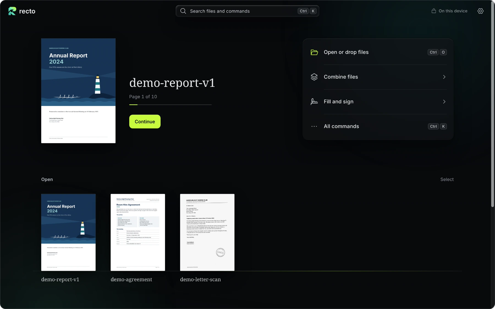
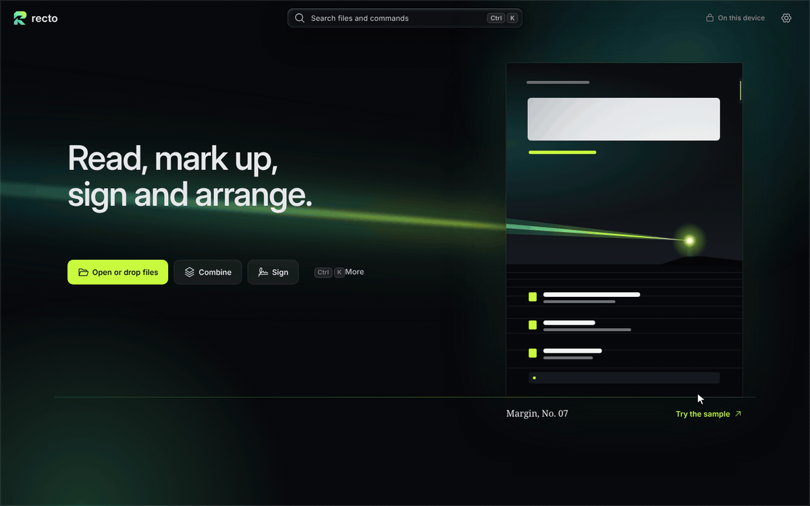
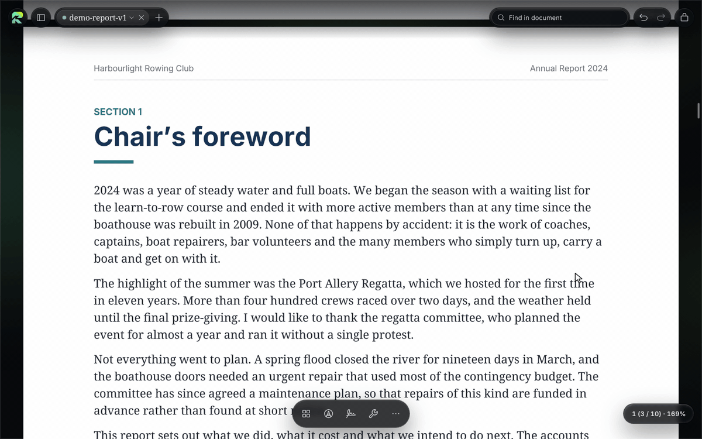
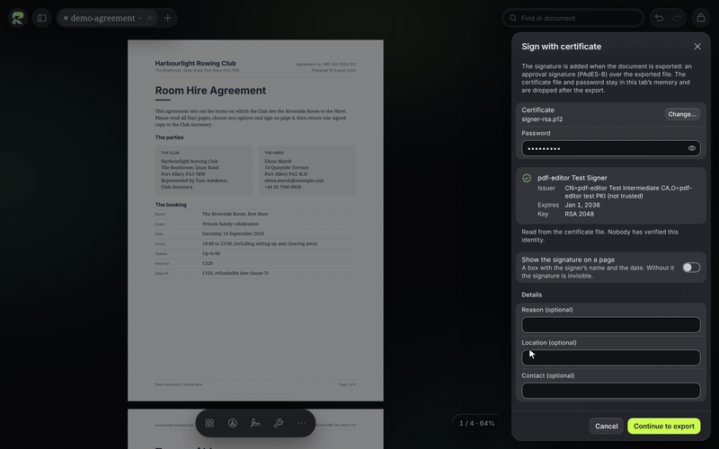
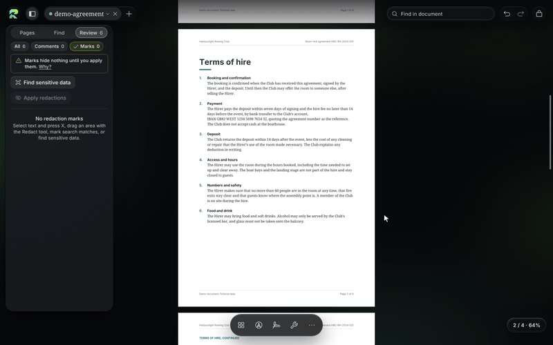
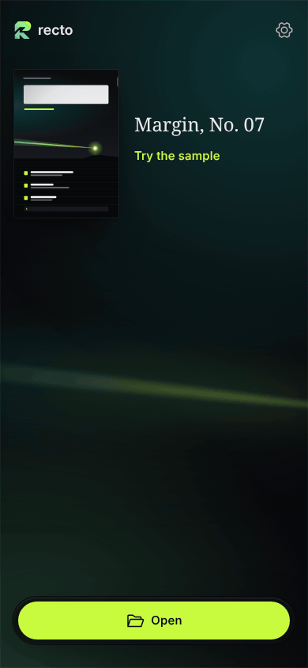
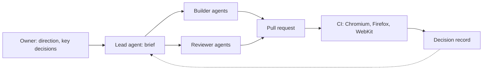

<div align="center">


<h1>Recto</h1>

**A PDF editor that runs entirely in your browser. Nothing is uploaded.**

[Open the app](https://erendenizk.github.io/recto/) · [Check it yourself](#check-it-yourself) · [Quick start](#quick-start) · [How it's built](#how-its-built)

[](https://github.com/ErenDenizK/recto/actions/workflows/ci.yml)
[](LICENSE)

<a href="https://erendenizk.github.io/recto/"></a>

</div>

Open many PDFs in one place. Arrange their pages, mark them up, fill and sign, redact, edit
text, recognise scans and compare versions. Everything runs on your device, in Chromium, Firefox
and Safari, and keeps working offline after the first visit. Public beta.

## What you can do

<table>
<tr>
<td width="50%" valign="top">
<br>
<b>Many files, one workspace.</b> Open several PDFs and move pages between them on one grid.
</td>
<td width="50%" valign="top">
<br>
<b>Mark up.</b> Highlight, pen, text, notes, shapes and stamps, saved as standard annotations.
</td>
</tr>
<tr>
<td valign="top">
<br>
<b>Fill and sign.</b> Sign with your own certificate. Recto says what it checked and never calls a signature "valid".
</td>
<td valign="top">
<br>
<b>Redact.</b> Removes the content under each mark, then checks the saved file for it.
</td>
</tr>
<tr>
<td valign="top">
<br>
<b>On your phone.</b> A reader with pen, highlight, text, edit text and signature by touch.
</td>
<td valign="top">
<b>And more.</b> Edit a line of text in its own font, recognise scans in nine languages, compare
two versions, turn pages into Markdown, and run saved steps over many files.<br><br>
What it does not do yet: <a href="docs/VISION.md">VISION.md</a> and the
<a href="docs/company/roadmap.md">roadmap</a>.
</td>
</tr>
</table>

## Check it yourself

There is no server to send a file to. The page's Content Security Policy allows connections to
its own origin only ([`index.html`](apps/web/index.html)), the app counts any request to another
origin behind its privacy button, and there is no account, cookie or telemetry.

## Quick start

Node.js 22 (see `.nvmrc`) and pnpm through Corepack.

```sh
corepack enable
pnpm install
pnpm dev          # http://localhost:5173
pnpm run ci       # format, lint, types, tests, build
```

To self-host, serve `apps/web/dist` from any static host over HTTPS. Layout and workflow:
[`CONTRIBUTING.md`](CONTRIBUTING.md) and [`docs/ARCHITECTURE.md`](docs/ARCHITECTURE.md).

## How it's built

I set the direction and make the key decisions: what Recto is, how it should feel and what
ships. A layered team of AI agents builds it, through the same GitHub process every time.

- **Lanes and pull requests.** A lead agent turns a decision into a brief. A builder agent works
  on its own branch, inside the files the brief owns, and a reviewer reads risky work first.
  Each lane is one pull request with What, Why and How tested.
- **Decision records.** Every decision is a dated row with its source, and a script keeps the
  [index](docs/process/decisions.md) in step with the rows.
- **CI on three engines.** Nothing merges until format, types, unit tests, size gates and the
  end-to-end suite pass on Chromium, Firefox and WebKit, on a tablet and on a phone.
- **Burn-in.** New and changed tests run several times over in CI before they can merge, so
  a flaky test is caught on its own pull request.



One lane from brief to merged pull request, with every link:
[the lane walkthrough](docs/process/lane-walkthrough.md).

| As of 2026-11-11 | | Source |
|---|---|---|
| Commits on `develop` | 2,084 | [GitHub](https://github.com/ErenDenizK/recto/commits/develop) |
| Pull requests merged | 189 | [GitHub](https://github.com/ErenDenizK/recto/pulls?q=is%3Apr+is%3Amerged) |
| Decision rows, ADRs | 322, 35 | [`decisions.md`](docs/process/decisions.md), [`docs/adr/`](docs/adr/README.md) |
| Tests per push | 7,399 unit, 1,843 end-to-end | [CI run](https://github.com/ErenDenizK/recto/actions/runs/42946486294) |

## Licence

[Apache-2.0](LICENSE). Bundled components and their licences: [`NOTICE`](NOTICE). Security
reports: [`SECURITY.md`](SECURITY.md).
