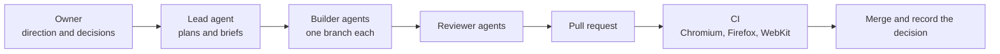

<div align="center">


# Recto

**A PDF editor that runs entirely in your browser. Your files never leave your device.**

[**Open Recto**](https://erendenizk.github.io/recto/) · [Run it locally](#run-it-locally) · [How it's built](#how-its-built)

[](https://github.com/ErenDenizK/recto/actions/workflows/ci.yml)
[](LICENSE)

</div>

<a href="https://erendenizk.github.io/recto/"></a>

## Why Recto

- **Private by design.** There is no server. Every PDF is opened, edited and saved inside the
  browser tab.
- **Many files at once.** Open several PDFs together and work across them in one place.
- **Works offline.** After the first visit Recto keeps working without a connection, on desktop,
  tablet and phone.

## What you can do

### Open many PDFs and arrange their pages


Open several files, then move, rotate, delete or extract pages across all of them on one grid.

### Mark up


Highlight, pen, text, notes, shapes and stamps, saved as standard PDF annotations that open in
any other reader.

### Fill and sign


Fill in forms and sign with your own certificate. Recto tells you exactly what it checked.

### Redact


Redaction removes the content under each mark instead of covering it, then checks the saved
file to confirm it is gone.

### On your phone

<p align="center"></p>

A reader built for touch, with pen, highlight, text, text editing and signature.

### And more

Edit a line of text in its original font · recognise scanned pages (OCR) in nine languages ·
compare two versions · turn pages into Markdown · run saved steps over many files.

## Your files stay yours

Recto has no account, no cookies and no analytics. The page is only allowed to connect to its
own address ([Content Security Policy](apps/web/index.html)), and the privacy button in the app
counts any request to anywhere else. You can confirm it in your browser's network panel.

## Run it locally

You need Node.js 22 (see `.nvmrc`) and pnpm, through Corepack.

```sh
corepack enable
pnpm install
pnpm dev        # http://localhost:5173
```

`pnpm run ci` runs everything CI runs: format, lint, types, tests and the build. To host your
own copy, serve `apps/web/dist` from any static host over HTTPS.

**Built with** React 19, TypeScript and Vite · PDFium compiled to WebAssembly, running in a
Web Worker · WebGL2 for the glass surfaces · Paraglide for English and Turkish.
More in [`docs/ARCHITECTURE.md`](docs/ARCHITECTURE.md).

## How it's built

Recto is built by one person working with a team of AI agents. I set the direction and make the
important decisions: what Recto is, how it should feel and what ships. The agents do the
building, through the same GitHub process every time.



- **One task, one pull request.** Every change starts as a written brief and lands as a pull
  request that says what changed, why, and how it was tested.
- **Every decision is written down.** Each one is a dated row with its source in the
  [decision log](docs/process/decisions.md).
- **Nothing merges on red.** Format, types, unit tests, size limits and the end-to-end suite
  must pass on Chromium, Firefox and WebKit, on a tablet and on a phone.
- **Flaky tests are caught early.** New and changed tests run several times in CI before they
  can merge.

To follow one real change from brief to merge, read
[the lane walkthrough](docs/process/lane-walkthrough.md).

So far: 2,084 commits, 189 merged pull requests, 322 recorded decisions, and 7,399 unit and
1,843 end-to-end tests on every change (as of 11 November 2026).

## Contributing and licence

See [`CONTRIBUTING.md`](CONTRIBUTING.md) to get involved and [`SECURITY.md`](SECURITY.md) to
report a security issue. Recto is released under the [Apache-2.0](LICENSE) licence; bundled
components are listed in [`NOTICE`](NOTICE).
