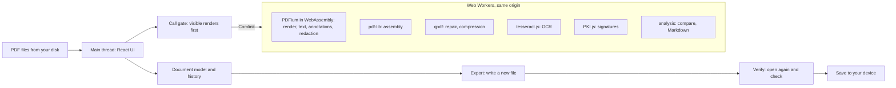

<div align="center">


<h1>Recto</h1>

**A PDF editor that runs entirely in your browser. Nothing is uploaded.**

Open many PDFs, arrange their pages on one light table, mark up, fill and sign, redact, edit
text, recognise scans, compare.

[Open the app](https://erendenizk.github.io/recto/) · [About page](https://erendenizk.github.io/recto/about/) · [Check it yourself](#check-it-yourself) · [How it works](#how-it-works) · [How it's built](#how-its-built)

[](https://github.com/ErenDenizK/recto/actions/workflows/ci.yml)
[](LICENSE)

</div>

<a href="https://erendenizk.github.io/recto/"></a>

**Status:** public beta. One owner sets the direction and makes the important decisions; a team
of AI agents builds it through pull requests, decision records and CI on Chromium, Firefox and
WebKit ([How it's built](#how-its-built)). Not audited by a third party. The images on this page
are recorded by a script from the deployed build.

## Why it exists

Your files stay on your device, and you can check that. Pages are rendered, edited and written
by WebAssembly engines in Web Workers inside the browser tab; there is no server to send a file
to, and the page's Content Security Policy allows connections to its own origin only.

One workspace instead of a page of single-purpose tools. Open several PDFs and they share one
light table: move pages between them, then mark up, fill, redact or sign in the same session,
with undo, and without a download and an upload between steps.

Correctness first. Every export is opened again and checked before it is offered
([`export-service.ts`](apps/web/src/export/export-service.ts)), and redaction removes the
content under each mark instead of drawing a box over it.

## What it does

| | What it does | Where it stops | Evidence |
|---|---|---|---|
| **Arrange** | Drag pages between open PDFs; bookmarks, links, page labels and form fields follow them on export. | An export writes a new file, so signatures in a source are removed, and the dialog says so. | [e2e](apps/web/e2e/pages-grid.spec.ts) · [golden files](packages/engine/test/merge-golden.test.ts) |
| **Mark up** | Pens, highlighter, text boxes, notes, shapes, images, stamps, fields; each a standard annotation and one undo step, read back by PDFium and pdf.js in CI. | On a phone: pen, highlight, text and signature only. | [annotation matrix](docs/qa/annotations-matrix.md) |
| **Redact** | Removes the text, images and paths under each mark, then re-reads the final bytes; the download is blocked if redacted text is still there. | JBIG2, CCITT and JPEG 2000 images cannot be searched and are listed as not searched. | [e2e](apps/web/e2e/redaction.spec.ts) · [check](packages/engine/src/redaction/verify-output.ts) |
| **Sign** | Signs exports with your .p12 or .pfx certificate (PAdES-B) and names what was checked: Intact, Changed after signing, Cannot check. | Never "valid": identity, trust and revocation are not checked; no LTV. | [e2e](apps/web/e2e/signatures.spec.ts) · [ADR-0013](docs/adr/0013-signature-validation-and-signing.md) |
| **Edit text** | Edits a line in its own embedded font when the font has the characters; otherwise a bundled font, and the export lists which. | One line at a time; paragraphs do not reflow. | [e2e](apps/web/e2e/text-edit.spec.ts) |
| **Recognise** | OCR adds an invisible, searchable text layer; nine languages, packs served from this site. | Tested end to end in Chromium only so far. | [test](packages/engine/src/ocr/layer.test.ts) · [e2e](apps/web/e2e/ocr.spec.ts) |
| **Compare** | Matches pages, then outlines changed areas and words, with an onion skin. | Shows differences; does not merge them. | [e2e](apps/web/e2e/compare.spec.ts) |
| **Markdown** | Turns pages into Markdown or plain text with headings and page breaks, images in a ZIP. | Reading order is a heuristic; tables are not detected. | [e2e](apps/web/e2e/convert.spec.ts) |
| **Batch** | Runs saved steps over many files. | A recipe never stores a password. | [e2e](apps/web/e2e/batch.spec.ts) · [ADR-0014](docs/adr/0014-recipe-format.md) |
| **Phone** | Its own edition: a reader with pen, highlight, text, edit text and signature by touch. | The other tools stay on desktop and tablet. | [ADR-0034](docs/adr/0034-editions.md) |

### Move pages between documents


### Redact, and the text is gone


### Recognise a scan


### Compare two versions


The [about page](https://erendenizk.github.io/recto/about/) has every clip, including Markup,
signing and the phone edition.

## Check it yourself

1. The Content Security Policy in [`apps/web/index.html`](apps/web/index.html) says
   `connect-src 'self'`: the page may fetch from its own origin only.
2. The app counts requests to other origins and shows the count behind its privacy button
   ([`external-requests.ts`](apps/web/src/privacy/external-requests.ts)). It reads Resource
   Timing, so it does not see WebSocket frames or requests the CSP blocked before they left.
3. After one visit the app works offline: a test reloads with the network off and renders a
   PDF ([`offline.spec.ts`](apps/web/e2e/offline.spec.ts), Chromium).
4. The OCR engine and its nine language packs, about 22 MB together, come from the same origin
   and download only when you recognise text or choose to keep them
   ([`langs.lock.json`](packages/engine/ocr/langs.lock.json)); the OCR test asserts that no
   request leaves the origin ([`ocr.spec.ts`](apps/web/e2e/ocr.spec.ts)).
5. There is no telemetry, no account and no cookie: search the source for `document.cookie`,
   `sendBeacon` or an analytics host.
6. What stays on your device: the app in the service worker's cache; engines, fonts and kept
   OCR packs in the `pdf-editor-wasm`, `pdf-editor-fonts` and `pdf-editor-ocr` caches; open
   documents and their edits in the origin private file system, so a reload can restore them
   ([`storage.ts`](apps/web/src/session/storage.ts)); closed ones in Recents for 30 days or up to
   500 MB ([`retention.ts`](apps/web/src/session/retention.ts)); preferences in `localStorage`
   under `pdf-editor:`. Clear it all in the privacy popover or by clearing the site's data.
7. The media on this page were recorded by a script that logs every request and fails on any
   other origin ([`privacy.ts`](tools/media/lib/privacy.ts)); the log is published as
   [`requests.log`](https://erendenizk.github.io/recto/media/requests.log).

## How it works



- **PDFium in a worker.** The engine inside Chromium, compiled to WebAssembly, in a Web Worker
  of its own ([ADR-0011](docs/adr/0011-engine-hosting-for-content-editing.md)).
- **A call gate on the main thread.** Visible page renders go ahead of the app's other calls to
  that worker; thumbnails of a 300-page file arrived 29% sooner with identical pixels. A second
  worker and native compression were measured and not kept (PF-24 to PF-26 in
  [`decisions/product.md`](docs/process/decisions/product.md), [#193](https://github.com/ErenDenizK/recto/pull/193)).
- **Glass on the GPU.** One WebGL2 canvas refracts the page bitmaps under the capsule and bars,
  draws only when the scene moves, keeps text over it at 4.5:1 or better, and falls back to CSS
  on software renderers and under reduced transparency (GLS-12 to GLS-15 in
  [`decisions/glass.md`](docs/process/decisions/glass.md)).
- **Installable and offline.** A service worker keeps the app and its engines; size gates in CI
  hold the first paint to 120 KB of script and are never raised to fit a change
  ([`bundle-budget.json`](tools/qa/bundle-budget.json), PRC-11).

The document model refers to the source pages and keeps every change in its history; a new file
is written only on export. Details: [`docs/ARCHITECTURE.md`](docs/ARCHITECTURE.md).

## How it's built

Recto is directed by one owner and built by a team of AI agents, organised like a small company
with written rules. As of 2026-11-11:

| | |
|---|---|
| **2,084** commits on `develop` | since 2026-09-26 |
| **189** pull requests merged | one concern each, since PRC-17 (2026-10-16) |
| **321** decision rows, **35** ADRs | [`decisions.md`](docs/process/decisions.md), [`docs/adr/`](docs/adr/README.md) |
| **7,399** unit and component tests, **1,843** end-to-end tests per push | Chromium, Firefox, WebKit, tablet, phone, phone landscape, no-GPU ([CI run](https://github.com/ErenDenizK/recto/actions/runs/42946486294)) |
| **63** agent lanes measured, **16** lessons | [`agent-metrics.md`](docs/process/agent-metrics.md), [`lessons.md`](docs/process/lessons.md) |

**Who decides.** The owner is the board: vision, scope, releases, taste, anything public. A
lead agent session is the chief executive: a scheduled task wakes it three times a day; it picks
work from the [roadmap](docs/company/roadmap.md), writes briefs, opens lanes, settles technique
as decision rows, merges, and reports in the HQ issue
([#26](https://github.com/ErenDenizK/recto/issues/26)). See the [charter](docs/company/charter.md).

**Who builds.** Agents are hired per lane and leave when they report: an `implementer` builds a
settled spec inside the files its brief owns and stops on any open question; a `reviewer` reads
risky work before its pull request; a `design-critic` holds screenshots to the quality bar
([Q-1 to Q-14](docs/design/redesign-2026-10/quality-bar.md)); readers search code and read CI
logs. Work is routed by role (judge, builder, reader) and every lane is measured
([`model-routing.md`](docs/process/model-routing.md)).

**How work lands.** Lanes own folders, so parallel agents never edit the same file
([`agent-workflow.md`](docs/process/agent-workflow.md)). Each lane is a pull request with What,
Why, How tested and the decisions it adds, merged with a merge commit once format, lint, types,
unit tests, the build's size gates and the end-to-end matrix are green
([`ci.yml`](.github/workflows/ci.yml)). Every decision is a row with its date and source, and a
script keeps the index honest ([`decisions-index.ts`](tools/qa/decisions-index.ts)).

One lane from brief to decision row, with every link:
[the engine scheduling lane, end to end](docs/process/lane-walkthrough.md).

## What it does not do

- Office files convert to PDF on desktop and tablet only, behind a flag (`?office=1`) and after a
  one-time download of about 70 MB; PDF to Office does not exist
  ([ADR-0035](docs/adr/0035-on-device-office-conversion.md)). No PDF/A claims: conformance cannot
  be validated in the browser ([`VISION.md`](docs/VISION.md)).
- Signatures are Intact, Intact but changed later, Changed after signing, Broken or Cannot
  check, never "valid": signer identity, trust and revocation are not checked, and there is no
  long-term validation (LTV) ([ADR-0013](docs/adr/0013-signature-validation-and-signing.md)).
- Text is edited one line at a time; paragraphs do not reflow.
- Markdown export guesses the reading order and does not detect tables.
- OCR, compare and the signing download are tested end to end in Chromium only, until the beta
  closes that gap.
- No collaboration, no cloud sync and no server API.
- One document is processed by one single-threaded WebAssembly worker; about 1 GB per document
  is the design ceiling ([ADR-0004](docs/adr/0004-hosting-and-isolation.md)).

## How it compares

| | Hosted PDF sites | Self-hosted toolkits | Browser viewers | Recto |
|---|---|---|---|---|
| Where files go | the provider's server | your server, or the browser | stay in the browser | stay in the browser |
| Free use | most limit tasks per day, file size, or the download | some meter automation | no limits | no limits |
| Shape | a page of single-purpose tools | a page of tools | one file at a time | one workspace for many files |
| Where they are better | dozens of tools, nothing to install | Office conversion, a server API, batch runs over folders | already installed | |

By category, not by product, as of 2026-09-26; sources in
[`docs/research/02-market-and-ux.md`](docs/research/02-market-and-ux.md). The live plan is
[`docs/company/roadmap.md`](docs/company/roadmap.md).

## Use it

- Open [erendenizk.github.io/recto](https://erendenizk.github.io/recto/) in a current
  Chromium-based browser, Firefox or Safari.
- Install it as an app: Install in the address bar of Chromium-based browsers, or File → Add to
  Dock in Safari on macOS. It works offline after the first visit (tested in Chromium).
- Self-host: build from source (see Development), then serve `apps/web/dist` from any static
  host over HTTPS. For a sub-path set `VITE_BASE_PATH=/your/path/ pnpm build`.

## Development

Requires Node.js 22 (see `.nvmrc`) and pnpm via Corepack.

```sh
corepack enable    # once per machine; provides the pnpm version pinned in package.json
pnpm install       # dependencies and Git hooks
pnpm dev           # web app at http://localhost:5173
pnpm run ci        # format check, lint, typecheck, tests, build
```

See [`CONTRIBUTING.md`](CONTRIBUTING.md) for the workflow and repository layout, and
[`docs/README.md`](docs/README.md) for the newcomer set of documents.

## Built on

PDFium (BSD-3-Clause) through EmbedPDF (MIT) · @cantoo/pdf-lib (MIT) · qpdf (Apache-2.0), built
from source in CI · tesseract.js and the tessdata_fast language packs (Apache-2.0) · PKI.js
(BSD-3-Clause) · pixelmatch (ISC) · jsdiff (BSD-3-Clause) · Inter, JetBrains Mono and Noto Serif
(SIL Open Font License 1.1). Nothing is loaded from a CDN. Bundled components and their copyright
lines: [`NOTICE`](NOTICE).

## Contributing · Security · Licence

- Contributing: [`CONTRIBUTING.md`](CONTRIBUTING.md): English, Conventional Commits, a changeset
  for each user-visible change.
- Security: report privately as described in [`SECURITY.md`](SECURITY.md).
- Licence: [Apache-2.0](LICENSE) ([ADR-0001](docs/adr/0001-license.md)).
