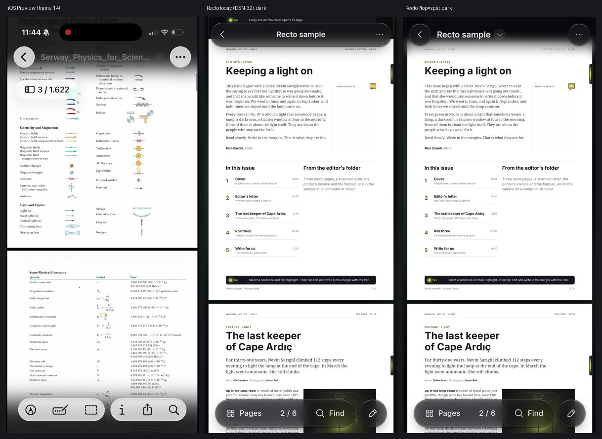
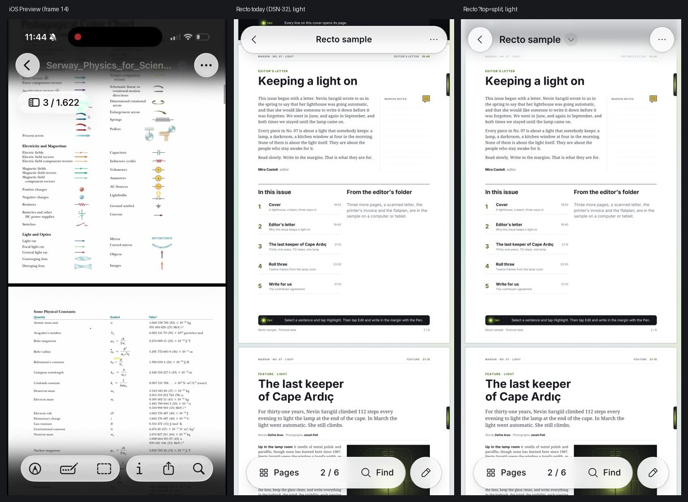
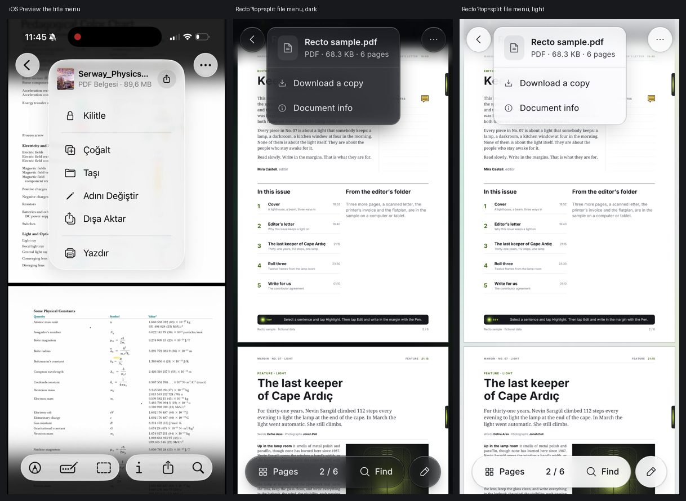
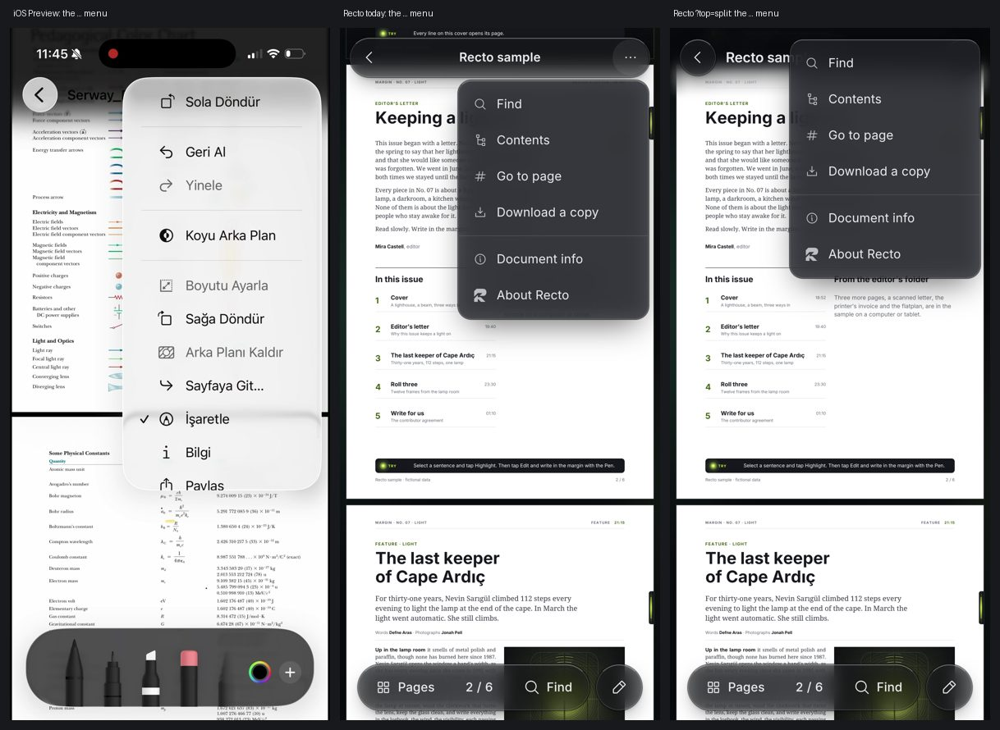
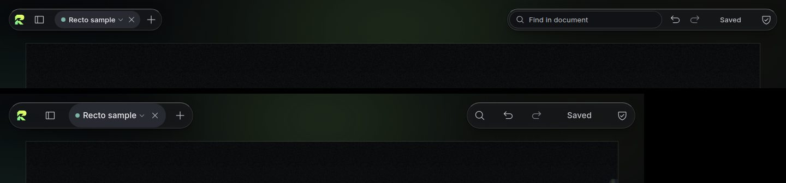

# iOS Preview as a reference for the phone edition (2026-10)

**Status:** reference and proposal. The split top it led to (DSN-34, DSN-35) is the phone
reader's default since the owner chose it (DSN-37); the capsule top (DSN-32) stays behind
`?top=capsule`. Built on those choices: the centred title cut in its middle and the lighter fade
(DSN-38), the liquid ⋯ and file menus and Find on the keyboard (DSN-39), the fade following the
page (DSN-40). Sections 2 and 4 below describe the state before those choices.

**Source:** the owner's screen recording of iOS 26 Preview (2026-10-15, 54 s, 1206 × 2622),
with the note: "a very stylish app; it has its own flaws, but it's a good reference, especially
for the top (tab/bar), for having more separate parts, for the toolbar, and for glass surfaces."
Ours was shot from a production build at 390 × 844 (3×, touch) in both themes, 844 × 390 on its
side, and 1440 × 900 / 1180 × 820 for the full edition's strip. The Chromium shots have no status
bar or safe area, so the scroll-edge fade sits at the very top there; on an iPhone it sits under
the status bar as Preview's does.

## 1. Verdict in short

| Pattern | Verdict |
|---|---|
| No top band: ‹ and ⋯ as their own glass circles, the title as text | **Adapt**, built behind `?top=split` (§2.1) |
| Scroll-edge fade under the status bar and the pieces | **Adapt**, with a tint that keeps the title legible (§2.3) |
| Title ▾ opens a file card menu | **Adapt**: name, size, pages, Share or Download, Info (§2.2) |
| ⋯ menu morphs out of its button | **Adopt** in both tops (container transform, §2.9) |
| "n / N" page pill under the title | **Skip** at rest: the capsule already says it (§2.4) |
| One glass capsule of six unlabelled icons at the bottom | **Skip**: ours keeps two or three labelled actions (EDN-7) (§2.5) |
| Markup capsule with drawn tools, colour wheel, small option card | **Adapt later**, for the tool drawer lane (§2.6, §2.7) |
| Colour sheet with Grid / Spectrum / Sliders tabs | **Skip** on a phone (INK-2, DSN-25) (§2.8) |
| Find bar riding on the keyboard | **Skip for now**, an alternative for the owner (§2.11) |
| Library grid with a bottom tab bar and a top-right cluster | **Skip** (DSN-31, DSN-33) (§2.13) |

## 2. Pattern by pattern

Each pattern lists what Preview does, what we do today, the verdict and the cost.

### 2.1 The top: separate pieces, no bar

- **Preview:** no top band. The back button is its own glass circle (44 pt) at the leading edge,
  ⋯ its own glass circle at the trailing edge, and the title floats between them as text,
  leading-aligned, with a small ▾ in a grey dot. All three ride over a scroll-edge effect. The
  chrome stays on screen while reading.
- **Recto today:** one floating M2 capsule (DSN-32), 48 px high, max(safe area, 12 px) from the
  top and the sides: ‹, the title centred, ⋯. It hides on scroll with the bottom capsule.
- **Verdict: adapt** (DSN-34). Built behind `?top=split`, kept for the tab's session
  (`pdf-editor:top:v1`) as `?drawer=list` is; `?top=capsule` goes back. ‹ and ⋯ are 44 px circles
  of the capsule's M2 (σ 7, coverage registry `compact-top-circle`, the light theme's denser sheet
  tint), the title is the callout size at 600, leading as Preview's, with the ▾ in a 24 px dot. The
  row keeps today's 48 px box and offset, so the pages lay out the same in both tops. Unlike
  Preview it still hides on scroll and on a tap, with the capsule (DSN-32's rule): the phone's
  screen goes to the page. Find is the capsule top's field in both variants.
- **Cost:** small. One component and one CSS module (about 1.3 KB gzip in the compact chunk),
  one registry entry. No change for anyone who does not ask for it.

### 2.2 The title and its ▾: the file menu

- **Preview:** the ▾ opens a glass card that grows from the title: the file's thumbnail, name,
  "PDF Belgesi · 89,6 MB" and a share glyph, then Lock, Duplicate, Move, Rename, Export, Print.
- **Recto today:** the title is a heading; it opens nothing. The file's facts live in Document
  info (⋯), Share or Download in ⋯.
- **Verdict: adapt.** The split top's ▾ opens a file menu of the ⋯ menu's recipe (M4), laid over
  the title and grown out of it: a card with a file glyph, the name **whole on up to two lines**
  (where the title truncates) and "PDF · size · pages", then Share or Download a copy (with the
  "Changed" rows once the file was edited, as in ⋯) and Document info. Lock, Duplicate, Move and
  Rename are file-system acts a browser tab does not have; Print has no reliable path for a PDF we
  render to canvas. A page thumbnail in the card was left out: it needs the renderer on the
  reader's first paint for a glyph's worth of information.
- **Cost:** small, built.

### 2.3 The scroll-edge effect

- **Preview:** the content under the status bar and the top controls fades and blurs
  progressively, darker towards the top (dark mode), so the controls never sit on a hard edge.
- **Recto today:** nothing; the capsule's own glass separates it from the page.
- **Verdict: adapt** (DSN-35). A fixed band from the top of the window to 28 px below the row:
  the canvas's own colour as a gradient (92 % at the top, 72 % at the title's line, 40 % at the
  row's foot, none at the bottom) over an 8 px backdrop blur that a mask fades out with it. Two
  declarations, no script per frame. It fades out with the pieces when they hide. Glass Solid,
  the cost ladder's last step and reduced transparency drop the blur and keep the tint. It and
  the two circles count as one glass surface (Q-11, `data-glass-group`), so the reader's budget is
  unchanged at three.
- **Cost:** small. A blurred band is the costliest piece of the variant on a phone GPU; it is one
  layer, the window's width by about 90 px.

### 2.4 The page indicator

- **Preview:** a glass pill "1 / 1.622" with a sidebar glyph at the top-left under the back
  button; it shows at rest and while scrolling, and opens the thumbnail sidebar.
- **Recto today:** "n / N" is the bottom capsule's middle button (it opens Go to page); while the
  chrome is hidden a small solid pill shows the page for 1.5 s after a scroll.
- **Verdict: skip at rest** (DSN-34). A second counter would say the same thing twice, and a
  pill under the title is one more surface over the page's top lines. *Alternative for the
  owner:* move our transient pill from the bottom to Preview's top-left place.
- **Cost:** none (not built); the alternative is small.

### 2.5 The bottom toolbar

- **Preview:** one glass capsule of six icons, unlabelled: Markup, Form, Select, Info, Share,
  Find.
- **Recto today:** one capsule of three labelled actions (Pages · n / N · Find) and the ✎ circle
  beside it that morphs it into the edit island (EDN-7, EDN-8).
- **Verdict: skip.** Six unlabelled glyphs are what EDN-7 asked us not to do ("two or three
  actions"); Info and Share are rarely used and live in ⋯. Preview's capsule does confirm the
  shape we have: one glass capsule, nothing else at the bottom.
- **Cost:** none.

### 2.6 The markup palette

- **Preview:** a dark glass capsule with the tools drawn as objects (pen, marker, pencil,
  eraser, lasso) standing in a row, the active one raised, then a colour wheel and ＋.
- **Recto today:** the edit island (Undo · tool chip · Done) and the tool drawer or list
  (EDN-8, EDN-16, EDN-18).
- **Verdict: adapt later.** The drawn tools read at a glance and the raised tool is a clear
  "armed" state; a drawn set is an illustration job (icons and the first-paint budget), and the
  drawer lane owns the place. Kept here as a reference for that lane.
- **Cost:** medium (drawn assets in both themes, the drawer's layout).

### 2.7 Tool options as a small card

- **Preview:** a tap on the armed tool pops a small glass card above the palette: five stroke
  widths and an opacity strip with a lens thumb.
- **Recto today:** the drawer's options row (sizes as dots, colours), EDN-13.
- **Verdict: adapt later**, with §2.6: a card that grows from the tool is the container transform
  we already have.
- **Cost:** small once §2.6 is decided.

### 2.8 The colour sheet

- **Preview:** a sheet with Grid / Spectrum / Sliders tabs, an eyedropper, an opacity slider and
  a row of saved colours with ＋.
- **Recto today:** the pens' three colours on the phone; the full edition's ink strip shows the
  wheel and recents (INK-2, INK-4).
- **Verdict: skip** on a phone: tabs inside a colour sheet are the layering DSN-25 removed, and a
  phone's pens are presets. The opacity slider with a checkerboard track is worth a look for the
  full edition's picker (INK-4).
- **Cost:** none.

### 2.9 The ⋯ menu morphs out of its button

- **Preview (30 fps):** the press lights the circle (about 100 ms), then the circle becomes a
  glass blob that swells down and to the left into the menu (about 270 ms), its content blurred
  until it settles; closing shrinks it back into the circle, which reappears. The menu covers the
  button it came from.
- **Recto today:** the ⋯ menu dropped below the capsule on a 0.96 scale and a fade. The full
  edition's container transform (MOT-5, `ui/container-transform.ts`) was never installed on the
  phone, although the overview's bar says its pop-ups use it.
- **Verdict: adopt** (DSN-36). The compact edition installs the container transform once the
  browser is idle after the reader opens (a lazy chunk, outside the compact closure): the ⋯ menu,
  the file menu and the overview's pop-ups grow out of their button's rounded rect by a clip and a
  translate, on *quick*, and go back into it on *press* with the receive pulse. In the split top
  the menu lies over its circle (offset −44 px), so it grows out of the circle in place as
  Preview's does; in the capsule top it stays below the bar. Reduced motion: opacity only. A row
  that opens a sheet closes the menu at once (`ui/menu-handoff.ts`), never shrinking through the
  rising sheet (Q-7). Preview's liquid deformation and the content's blur-in are skipped: a
  blurred, deforming surface is a filter animation, which the materials never do (language.md
  §2.1 rule 5).
- **Cost:** small, built.

### 2.10 What the ⋯ menu holds

- **Preview:** sectioned: Rotate left, Undo / Redo, Dark background, Resize, Rotate right,
  Remove background, Go to page…, Markup ✓, Info, Share (eleven rows, more than a screen's top
  half).
- **Recto today:** Find, Contents, Go to page, Share or Download, Document info, About.
- **Verdict: keep ours.** Undo and Redo belong to the edit island; rotation belongs to the
  overview (MOB-3). *Dark background* (an inverted page for night reading) is the one row worth
  a later look.
- **Cost:** none now.

### 2.11 Find

- **Preview:** a glass bar riding on the keyboard: ✓ (done) in a lime circle, the field,
  ▲ ▼.
- **Recto today:** the top bar becomes the field with the count, ‹ › and Done; the capsule steps
  away.
- **Verdict: skip for now.** On the keyboard the field is near the thumb, but the count and the
  hit it names sit far from the highlighted line, and `interactive-widget=resizes-content` plus
  the keyboard hold (EDN-17) would have to carry one more bar. *Alternative for the owner.*
- **Cost:** medium.

### 2.12 Document info

- **Preview:** a full sheet, a two-column table of facts.
- **Recto today:** the Document info sheet, the same idea. **Same; no change.**

### 2.13 The Library

- **Preview:** a grid of thumbnails, a top-right cluster of four glass buttons, and a bottom
  glass tab bar (Recents · Shared · Browse) that shrinks to a lit circle while scrolling.
- **Recto today:** a composed home (DSN-31): the mark, the promise, the sample card, Recents as
  rows, Open PDF in a floating dock; the page scrolls itself (DSN-33).
- **Verdict: skip.** A browser tab has no Shared or Browse; a grid of thumbnails needs the
  renderer before a file is chosen. The tab bar's shrink-on-scroll is a nice touch for a later
  Library with more than one section.
- **Cost:** none.

### 2.14 Glass

- **Preview:** clear, bright glass circles and capsules with lensing at the edges, the same
  family top and bottom; dark glass for the markup palette.
- **Recto:** the materials (Clear · Tinted · Solid, M1–M5); lensing exists only on Chromium for
  fixed M1 chips (language.md §2.7). The split top keeps one family: the circles are the bottom
  capsule's M2.
- **Verdict:** nothing to change; Preview confirms the family rule.

### 2.15 The full edition's top strip (desktop and tablet)

The strip is already two floating glass pieces with the page between them (owner feedback F1,
DSN-30): Preview's "more separate parts" is what the tablet and the desktop have. No change.

## 3. Preview's flaws

1. **The title truncates** to "Serway_Physics_for_Scien…" and the title menu truncates it again
   ("Serway_Physics…"). Ours truncates in the row too, but the file menu shows the name whole on
   two lines, and the accessible name is whole.
2. **The scroll-edge effect greys the title out over a white page:** in dark mode the white title
   sits on a fading grey (frame 14) and loses contrast. Our band's tint is the canvas colour at
   72 % on the title's line, so the title keeps its contrast over white pages.
3. **The scroll-edge darkens the top of every page.** Ours does too while the chrome shows; it
   goes with the chrome on scroll and on a tap.
4. **Six unlabelled icons** at the bottom: Markup and Form are hard to tell apart; Info and Share
   are rare acts given the best place.
5. **The page pill covers the page's first lines** at the top-left, at rest.
6. **An eleven-row ⋯ menu** that mixes view, edit and file acts, with two dimmed rows (Undo,
   Redo) in the middle; it covers the title while open.
7. **Find's ✓** reads as "confirm", not "done".

## 4. Taste questions for the owner

1. **Split or capsule?** Compare `?top=split` and `?top=capsule` on the iPhone.
2. **The title:** leading, as Preview (built), or centred between the circles?
3. **The ▾:** in a grey dot (built), bare, or no ▾ with the whole title tappable?
4. **The fade's strength:** as built (72 % on the title's line), lighter as Preview's (more page
   shows, the title can grey out), or none (the circles alone)?
5. **The light theme over a dark page** (the sample's cover): the band is light, as the theme is.
   Keep, or always darken under the status bar as iOS does in light mode over dark content?
6. **The ⋯ menu over its circle** (built, as Preview) or below it (as the capsule top)?
7. **The page indicator:** keep it in the capsule only (built), or also move the transient pill to
   Preview's top-left place?
8. **Find on the keyboard** (§2.11): worth trying as a variant?

## 5. Cost summary

| Item | State | Cost |
|---|---|---|
| Split top (circles, title, ▾ file menu, fade) | Built, `?top=split` | 1.3 KB gzip in the compact chunk; one registry entry |
| ⋯ and file menus grow out of their button | Built, both tops | The container transform loads lazily; no compact-closure growth |
| Transient page pill at the top-left | Alternative | Small |
| Find on the keyboard | Alternative | Medium |
| Drawn markup tools and option card | Later, drawer lane | Medium |
