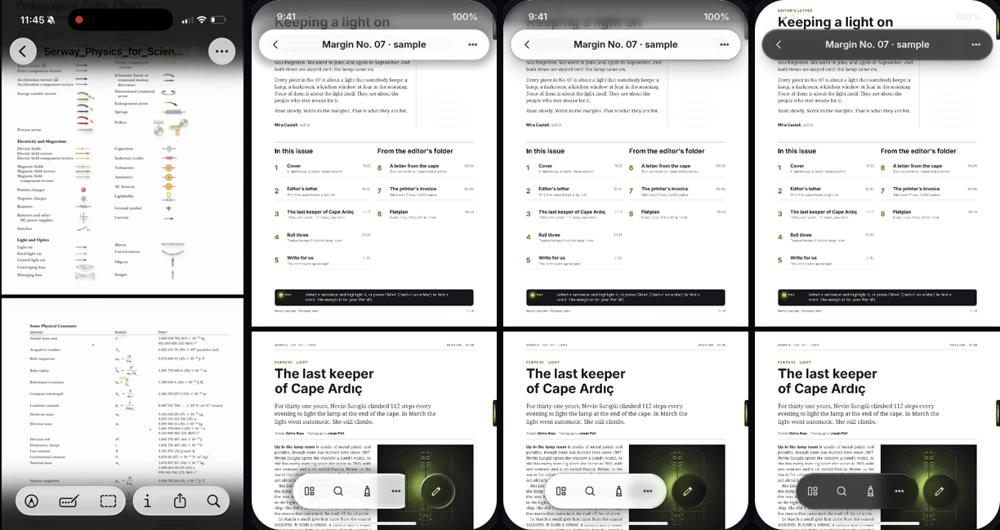
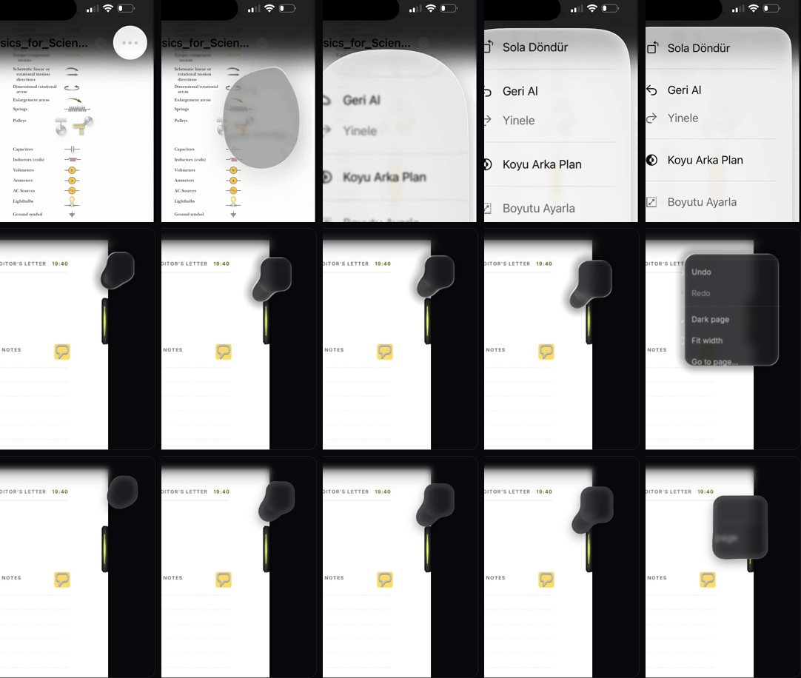
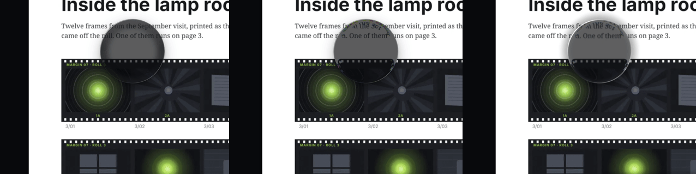
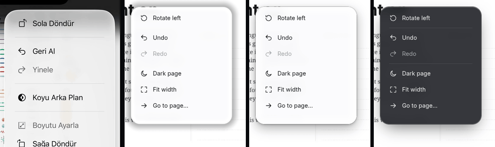

> Research snapshot of 2026-10-15 for the owner's ask (Turkish, paraphrased): "work on the glass,
> its animation, look, features and performance; there is an open-source React liquid glass that
> needs a GPU and is heavy but very stylish; study it in a separate glass lab until ours looks
> just like it." The reference video is the owner's iOS 26 Preview (Önizleme) screen recording
> (54 s, 1206 × 2622). **No third-party code was installed, built or run**: the four libraries
> were shallow-cloned into empty scratch folders and read with `cat` and `grep`; their pictures
> were seen only as the image files inside their own repositories. Everything that runs in the
> lab is Recto's own code. Cost numbers come from headless Chromium 141 on **SwiftShader**: every
> GPU step ran on the CPU, so they are **trends between tiers, not frame rates of any real
> device**.

# The liquid glass lab

## 0. Verdict

- **The owner meant Liquid DOM** (AndrewPrifer/liquid-dom, MIT): React 19 bindings over a
  **WebGPU** renderer that draws the whole scene (DOM content enters the GPU through Chrome's
  experimental HTML-in-Canvas flag) and shades fused liquid shapes every frame. It is the only
  candidate that is React, GPU-only, heavy and showcase-stylish at once (§1).
- **Its look is reachable without its architecture.** The look comes from four things: a bezel
  that bends the backdrop by Snell's law, a two-lobe rim light, fused (smooth-minimum) shapes,
  and choreography (a blob that swells into a menu). The lab reproduces all four in Recto's own
  code, in three tiers that degrade honestly (§5): **T0** CSS in every engine, **T1** an SVG Snell
  lens in Chromium, **T2** WebGL2 over the page raster we already own.
- **Most of what the owner sees in iOS 26 is not refraction.** It is the adaptive look (small
  controls turn light over white paper even in dark mode), the press light, the scroll edge and
  the blob morph. All four work in CSS (T0) in every engine (§4, §8).
- **Refraction is Chromium-only in CSS** (T1, as research 16 found), or needs our own GPU pass
  (T2). T2 is feasible because we render every page ourselves (ImageBitmaps from the PDFium
  worker), but it is a large integration (§5.4); keep it in the lab for now.
- **The lab costs the app nothing**: a build with the lab differs from one without only by the two
  lab files; first paint stays 119.8 / 120 KB and the precache is unchanged (§6.3).

---

## 1. Which library the owner meant

| Candidate | React | Needs a GPU | Heavy | Stylish showcase | Verdict |
|---|---|---|---|---|---|
| [AndrewPrifer/liquid-dom](https://github.com/AndrewPrifer/liquid-dom) | React 19 bindings (`@liquid-dom/react`), also Three and R3F | **WebGPU only** (`navigator.gpu`); DOM content also needs Chrome's `canvas-draw-element` flag | Renders and blurs the scene every frame (`frameloop: 'always'` by default), adaptive multi-level blur, a displacement prepass, a metrics pass | A dedicated showcase (`liquid-dom-showcase.vercel.app`: menu, control centre, notification centre, music sidebar, video controls) | **Most likely** |
| [iyinchao/liquid-glass-studio](https://github.com/iyinchao/liquid-glass-studio) | A React 19 + Vite **app**, not a library | WebGL2 or WebGPU | Multipass, full-screen | A parameter playground | Possible, but it is a tool, not something one would "use" |
| [naughtyduk/liquidGL](https://github.com/naughtyduk/liquidGL) | Vanilla JS | WebGPU → WebGL2 → WebGL1 → CSS fallback | Rasterises the page into a texture | Demos | Not React, falls back without a GPU |
| [rdev/liquid-glass-react](https://github.com/rdev/liquid-glass-react) | React | No: SVG filters and `backdrop-filter` | Light | A demo page | Not GPU |

"React, needs a GPU, heavy, very stylish" matches Liquid DOM on every count; the lead's guess
holds. Its last commit read was `dd342ab` (2026-09-07).

## 2. How each library works

### 2.1 Liquid DOM (MIT, © 2026 Andras Prifer)

Read: `packages/core/src/shaders.ts`, `scene.ts` (defaults), `corner-smoothing.ts`,
`ADAPTIVE_TINT.md`, `ADAPTIVE_BLUR_PERF.md`, the React README, and the showcase's `MenuDemo.tsx`.

- **Capture.** It owns the scene: a WebGPU canvas renders images, video, Three scenes and DOM
  (copied into GPU textures through HTML-in-Canvas: `<canvas layoutsubtree>` and paint events).
  Nothing is read from the page behind it.
- **Shape.** A smooth rounded rectangle with a p-norm corner:
  `d = ‖max(q, 0)‖ₚ + min(max(qₓ, q_y), 0) − r`, `q = |p| − h + r`, with p = 2 at smoothing 0 and
  p = 4 at the default smoothing 0.6 ("tuned for an iOS-like squircle").
- **Fusion.** Shapes in one container fuse by a finite smooth union,
  `min(a, b) − k · 0.25 · s²`, `s = clamp(1 − |a − b| / k)`, with the blend radius gated by the
  angle between the two normals (aligned normals stay hard, so a menu does not swell where it
  merely overlaps) and by how far one shape is submerged in another.
- **Bezel.** A height profile over the bezel width b: the convex squircle
  `h(x) = √(1 − (1 − x)⁴)`, x = inward distance / b, slope `h′ = 2(1 − x)³ / √(1 − (1 − x)⁴)`,
  capped at tan 85°. The slope field is written in a prepass and blurred (6 px) so the rim stays
  smooth where shapes fuse.
- **Refraction.** Normal `n = normalize(∇d · h′, 1)`; per colour channel
  `R = refract((0, 0, −1), n, 1 / (ior ± dispersion))`; displacement
  `Δ = R.xy / −R.z · (thickness + h · b) · factor`; the pixel samples the **blurred** backdrop at
  `p + Δ`. Defaults: ior 1.5, thickness 90, bezel 14, blur 8, dispersion 0.
- **Light.** A rim band `specularWidth` px wide (screen pixels, derivative-corrected), with
  `pow(max(n·L, 0), sharpness)` on the light side plus the same for −L (the far rim), white,
  opacity 0.45; a "reflection" sampled `reflectionOffset` px outside, kept only where the
  reflected sample is bright and the refracted one dark. Tint `mix(refracted, tint.rgb, tint.a)`,
  default white 0.15. Shadow: a blurred SDF mask offset 10 px, alpha 0.12.
- **Blur.** "Adaptive": downsample by powers of two until the radius fits a 13-tap kernel
  (σ 3), blur separably, upsample; the cost converges to ~2.7 reads per output pixel at large
  radii (its own note).
- **Adaptive tint.** A metrics pass returns the backdrop's luminance percentiles under each
  container; the docs recommend the **median**, a debounce and an eased tint change.
- **Animation.** Springs (default stiffness 300, damping 30) on every layout and glass property,
  sub-stepped at 60 Hz. The menu morph: closed menu = a 40 px round blob behind the button;
  open: centre spring 144/14 with a launch velocity, size eased 300 ms on
  cubic-bezier(0.8, 0.3, 0.5, 0.8), radius eased 700 ms, content blurred 8 → 0 px and scaled
  2 → 1 over 300 ms while its opacity springs (137/20); the button rides to the menu centre
  (499/22) and shrinks to half (155/24); content refraction (ior 1.5, depth 80) is switched on
  for one frame and eased off over 300 ms. Closing uses 130/18 and 90/20.
- **Cost and limits.** WebGPU only (no Safari before WebGPU shipped there, no Firefox stable on
  most platforms), DOM content behind a Chrome flag, full-scene rendering every frame.

### 2.2 Liquid Glass Studio (MIT, © 2024 Charles Yin)

Read: `src/shaders/fragment-main.glsl`, `lib/sdf.glsl`, the blur passes, `Controls.tsx`.

- **Capture.** Its own background (images, videos) drawn into a texture; two Gaussian passes
  (weights uploaded, radius up to 200) give the blurred copy.
- **Refraction.** Inside a band of thickness T from the edge (d = inward distance):
  `θᵢ = asin((1 − d/T)²)`, `θₜ = asin(sin θᵢ / n)`, edge factor `−tan(θₜ − θᵢ)`, sample at
  `uv − ∇d · edgeFactor · distance`. Defaults T = 20 px, n = 1.4, distance 0.05, blur radius 1
  (almost clear glass, like iOS controls).
- **Dispersion.** Channels at `offset · (1 − (Nᵢ − 1) · gain)` with N = 0.98 / 1 / 1.02, gain 7.
- **Fresnel and glare.** Fresnel `clamp((1 + d·k + hardness)⁵)` mixes towards white; glare is
  an angle lobe `0.5 + 0.5 sin(2(θ − π/4 + angle))`, brightened in LCH (L + 150, C + 30), far
  side × 0.8.
- **Merge.** The polynomial smooth minimum `mix(b, a, h) − k h (1 − h)` of a circle and a
  superellipse-cornered rectangle.

### 2.3 liquidGL (MIT, © NaughtyDuk)

Read: `README.md`, the WebGL2 and WGSL fragment shaders in `scripts/liquidGL.js`.

- **Capture.** Its own DOM rasteriser snapshots `<body>` into a texture (resolution 2); dynamic
  elements must be registered, CSS animations do not refract, and Safari is "unstable when the
  liquid element(s) are more than 50 % of the viewport" (README).
- **Refraction.** A heuristic: `edge = 1 − smoothstep(0, bevel, −d)`,
  `offset = edge · refraction + edge¹⁰ · bevelDepth`, along a corner-aware normal; defaults
  refraction 0.01, bevelDepth 0.08, bevelWidth 0.15 of the short side.
- **Frost** 16 random taps; **aberration** red and blue either side of the offset; **tint**
  multiplies; a "fluid" mode deforms the SDF towards the pointer.

### 2.4 liquid-glass-react (MIT, © 2025 Max Rovensky)

Read: `src/index.tsx`, `src/shader-utils.ts`, README.

- **Capture.** `backdrop-filter: blur() saturate()` on a layer that also has
  `filter: url(#svg)`: Chromium displaces the blurred layer; Safari and Firefox show the blur
  only (README).
- **Map.** A canvas "fragment shader" in JavaScript (after Shu Ding's liquid-glass, MIT):
  `displacement = smoothstep(0.8, 0, sdRoundRect(uv) − 0.15)`, encoded in red and green around
  128; dispersion by three `feDisplacementMap` passes at scale × (1, 1 − 0.05a, 1 − 0.1a), each
  kept to one channel and screened together.
- **Rims.** Two 1.5 px masked borders (`mask-composite: exclude`), `screen` and `overlay`
  blended, with a 135° gradient that turns with the pointer. "Elasticity": the pane stretches
  along the pointer's direction, `scale = 1 + |dir| · s · 0.3 − |⊥| · s · 0.15`.

### 2.5 Side by side

| | Liquid DOM | Studio | liquidGL | liquid-glass-react |
|---|---|---|---|---|
| Backdrop | owns the scene (WebGPU, HTML-in-Canvas) | own image/video | DOM snapshot | live `backdrop-filter` |
| Bend | Snell on a squircle bezel, per channel | Snell-like edge factor | heuristic edge¹⁰ | canvas-made map |
| Blur | adaptive multi-level | two Gaussian passes | 16 random taps | CSS blur |
| Light | two rim lobes + reflection | fresnel + angular glare | animated specular | gradient rims |
| Merge | gated finite smooth union | smooth min | none (stacking) | none |
| Engines | WebGPU (Chrome; DOM behind a flag) | WebGL2 / WebGPU | WebGPU → WebGL → CSS | Chromium bends; others blur |

## 3. Licences

| Library | Licence | Holder | Used here |
|---|---|---|---|
| Liquid DOM | MIT | Andras Prifer, 2026 | Formulas and spring constants restated and credited in `lab/glass/sdf.ts`, `t2-gl.ts`, `morph.ts`, `spring.ts`, `pieces.ts` |
| Liquid Glass Studio | MIT | Charles Yin, 2024 | The smooth-min and SDF are public formulas (Inigo Quilez); credited in `sdf.ts` |
| liquidGL | MIT | NaughtyDuk | Nothing adapted |
| liquid-glass-react | MIT | Max Rovensky, 2025 | The three-pass dispersion and the elasticity idea, credited in `t1-lens.ts` and `pieces.ts` |

No GPL code was read or copied. No source file was copied; formulas were re-derived and
re-written in TypeScript and GLSL.

## 4. What iOS 26 Preview does that Recto does not

From the owner's recording (frames at 1 fps, plus 30 fps around 39.4–40.0 s and full-size
frames at 13, 16.5, 36, 39, 40.6, 44 and 47 s):

1. **Adaptive look.** In dark mode over a white page, the back and ⋯ circles and both bottom
   capsules are *light* glass with dark glyphs (39 s); over the inverted page (44 s) they turn
   dark. The ink palette stays dark smoke even over white (16.5 s). Recto: one look per theme;
   over a white page every dark-theme surface is a mid-grey smoke (research 16 §6.1).
2. **Nearly clear controls with a strong rim.** Very little blur on the small controls; the
   page text shows through, stretched at the rim (13 s, the back button over "acceleration
   vectors"); a thin bright specular at the top left and a weaker one at the bottom right.
   Recto: σ 7–10 and the tier tint, a lit top border, the 6 px lens on chips in Chromium.
3. **Scroll edge.** The page fades into the chrome at the top under a progressive blur and a
   dark tint (all reader frames), and at the bottom behind the capsules. Recto: none on the
   phone reader (DSN-32 lets the page show all round the top bar).
4. **The ⋯ morph** (39.45–39.95 s): the button lights up white on press (~100 ms), turns into a
   dark round blob, the blob detaches down-left as an egg, grows into a tall oval while the
   content inside is heavily blurred and enlarged, then squares into the menu as the content
   sharpens; the rows near the top rim are visibly refracted in the last frames. About 450 ms
   in all; closing runs back into the button. The search capsule does the same towards the
   search field (36 s). Recto: MOT-5's container transform (a clip-path reveal from the
   trigger, text never scaled).
5. **Menu material.** The open menu over paper is light frosted glass, heavily blurred, with a
   darker band inside its top rim where it refracts the dark scroll edge above it.
6. **Press light.** Controls light up from within when pressed (the ⋯ turns white).

## 5. The lab

**Where:** `apps/web/lab/glass/` (served at **`/recto/lab/glass/`** on the live site, `/lab/glass/`
locally), a separate Vite input next to `about`, `noindex`, never loaded by the app (decisions
GLS-1). The page sets switchable backdrops (the English sample's pages 1–4 rendered with
`pdftoppm` at 130 dpi: the dark cover photograph, two white text pages, the photo page; a
synthetic dusk "photo"), Dark and Light, and shows:

- **Stage:** the pieces at app sizes (48 px top bar, 40 px page pill, a menu, the 56 px capsule
  and edit button, a 140 px lens disc), draggable with lift, stretch and wobble;
- **Morph and merge:** ⋯ → menu as one body, two capsules fusing (button or drag), slow motion;
- **Phone:** a 390 × 844 frame with the floating top bar, capsule, edit button and scroll edge;
- **Panel:** tier, theme, backdrop, sliders (blur, bezel, refraction, specular, tint, chromatic,
  merge distance, light angle), auto-scroll, scroll edge, shadows, the adaptive look, and a frame
  meter (fps, p50, p95, T2 draw time, blurred layers);
- **Notes:** the tier table and one card per library and for the recording.

### 5.1 Current

The real `tokens.css` and `materials.css`, loaded as CSS text (`?inline`): the chip, bar,
capsule and menu tiers exactly as they ship, and the app's 6 px gradient lens on the page pill
(restated from `material-lens.ts`, because the lab may not import app modules, §6.3).

### 5.2 T0, CSS only (every engine)

Four sibling layers per piece, each reading the real backdrop (never nested, Q-3):

| Layer | Recipe |
|---|---|
| Body | The tier's own `blur · saturate · brightness` (and `contrast` in light) and tint, so the contrast proofs of `tokens.test.ts` hold; a 0.5 px dark outer edge; inner light top and bottom; the drop shadow |
| Bezel | A band inside the rim with half the blur and a 1.28× brighter, 1.15× more saturated filter, faded towards the middle by an SVG mask (a rounded-rect stroke at twice the bezel, blurred): the thick edge catching light |
| Rim | A hairline whose `conic-gradient(from <light angle>)` is bright towards the light and at 55 % on the far side (Liquid DOM's two lobes) |
| Glow | A radial press light at the pointer (no backdrop work) |

Fused shapes (the morph, the merge) use **one** glass element per group whose body is
**masked by the outline of the smooth union** of its shapes, traced each frame by marching
squares (`contour.ts`, 2.5 px grid), with an SVG rim, bezel band and shadow along the same
path. `clip-path: path()` was tried first: in this Chromium a backdrop-filtered layer clipped by
a path left part of its filtered backdrop unclipped (a dark square corner on the menu blob), while
a static test of the same property clipped correctly; a mask of the same outline held in every
case (decisions GLS-4).

The adaptive look (off by default; an owner question, §8): each piece reads the **median**
luminance of the page raster under it (an 8 px luminance grid made once per backdrop), turns
light above 0.45 and dark below 0.2 (hysteresis), and switches to the other theme's tier
recipe, whose contrast the light-theme tokens already prove.

### 5.3 T1, the Snell lens (Chromium)

T0's body with `backdrop-filter: url(#lens) blur() …`. The map is drawn per size from the
rounded-rect SDF and its gradient, the bezel slope and Snell's law (`sdf.ts`), red and green
around 128, scale = 2 × the largest pull (capped at 28 px); dispersion by three passes at
(0.85, 1, 1.15) × scale, kept per channel and screened. Exact in corners and on capsule ends,
unlike the app's two linear gradients. The bezel layer is dropped (the real bend replaces it).
Safari and Firefox drop any `backdrop-filter` holding `url()`, so it is set inline only after
detecting Chromium. Verified in this Chromium with a stripe test and visibly in the lab
(`compare-optics.png`); hidden under blur at the default σ, obvious at σ 0.

### 5.4 T2, WebGL2 over our own page raster

One canvas per stage over the backdrop and under the controls' content. The backdrop column
(our page raster) is uploaded **once**, and blurred **once per σ** (half or quarter resolution,
separable Gaussian). Each frame then only shades the glass: per group a scissored quad
(members' box + 24 px, + the merge distance where shapes fuse), an early exit beyond 30 px,
the gradient only in the bezel band, Snell per channel, frost (sharp ↔ blurred), the tier
recipe and tint (and the other recipe for the adaptive look), the two-lobe rim, a halo shadow,
and the scroll edge as its own cheap pass. It reads the DOM boxes with
`getBoundingClientRect` each frame, so CSS and script animate plain elements and the shader
follows; it draws only when something changed. It is the closest to Liquid DOM and to the
recording (`compare-reader.png`, `compare-morph.png`).

**Feasibility in Recto.** The app already holds every visible page as an ImageBitmap
(`engine/bitmap-cache.ts`) and draws it into a 2D canvas (`pages/PageCanvas.tsx`), so a T2 layer
could upload the same bitmaps (no DOM snapshot, unlike liquidGL). What it would cost:

- **Coverage gaps:** anything not in the page bitmap is not refracted: ink and highlight
  overlays, selections, form fields, the text layer's highlights, notes, the aurora, the grid
  view's thumbnails, the Library. Each would need its own texture or would show unbent under the
  glass edge.
- **Sync:** the canvas must follow the viewer's scroll and zoom in the same frame (the lab reads
  `scrollTop` in its frame; with a compositor-driven scroll it can lag one frame at a fling).
- **Memory:** a 2× Letter page is ~8 MB of texture; the visible set is 2–6 pages.
- **Engines:** WebGL2 everywhere current, but it must stay off on software renderers (the app's
  `SOFTWARE_RENDERER` test) and on context loss, and phones would pay battery.

Verdict: technically sound, not worth the integration for the chrome alone today; T1 and T0
reach most of the look (§8).

## 6. Cost

### 6.1 Method

Headless Chromium 141 (`/opt/pw-browsers/chromium-1194`), `--use-angle=swiftshader`
(WebGL2 on SwiftShader: **software-rendered**), the production build served by `vite preview`,
the main stage on screen, its backdrop auto-scrolling at 240 px/s under the glass for 4 s after a
0.6 s warm-up, the rAF interval recorded (fps, p50, p95). Each scenario in a fresh page, three
rounds, medians; "none" is the same page with the pieces hidden. The container is shared with
other lanes, so expect ±30 % between runs. Script: the lab's `window.__glassLab.measure()`
driven by Playwright (`scratchpad/glass-lab/tools/perf.mjs`, not in the repository).

### 6.2 Results

Frame interval while the backdrop scrolls under the glass, ms (fps = mean rate). "Layers" counts
elements with a `backdrop-filter` in all three stages of the page (T0 has two per piece).

| Scenario | 1440 × 900 @1x: fps · p50 · p95 | 390 × 844 @2x: fps · p50 · p95 | Layers |
|---|---|---|---|
| No glass (pieces hidden) | 32.5 · 33.3 · 33.4 | 60.0 · 16.7 · 16.8 | – |
| Current (`materials.css`) | 16.7 · 66.6 · 66.8 | 29.5 · 33.4 · 50.0 | 14 |
| T0 (CSS) | 8.6 · 116.6 · 150.0 | 14.4 · 83.3 · 100.0 | 25 |
| T1 (T0 + Snell lens) | 9.6 · 100.0 · 133.3 | 16.8 · 66.7 · 83.4 | 15 |
| T2 (WebGL2) | 8.9 · 100.1 · 200.1 | 4.9 · 233.4 · 583.3 | 0 |

T2's own draw call returned in 0.6–1.1 ms of main-thread time (with `gl.finish()`), but on
SwiftShader its fragment work lands in the GPU process and shows only in the frame interval.
1440: three rounds; 390: two rounds, the higher one reported. Raw runs:
`scratchpad/glass-lab/perf-{1440,390}.txt` (session scratch, not in the repository).

Reading:

1. **Glass costs every frame something moves under it, and nothing at rest** (the lab's loop
   stops and T2 draws on change only). The stage holds six glass pieces, more than the app's
   four surfaces at rest, so Current already halves the scrolling frame rate on a CPU
   rasteriser.
2. **The bezel band is T0's price.** T0 costs about 1.75 × Current's frame time at 1440 and
   2.5 × at 390 @2x; nearly all of it is the second backdrop pass per piece (25 layers against
   14). T1, which drops that layer for the SVG lens, is 15–20 % cheaper than T0. The rim, the
   specular, the edge and the press light cost nothing measurable: they are gradients.
3. **T2 inverts on real hardware.** On SwiftShader the fragment shader runs on the CPU, so T2
   scales with shaded pixels: level with T1 at 1440 @1x, the slowest at 390 @2x (four times the
   pixels). On a GPU the same pass (one texture-sampling shader over the glass area, no
   per-frame blur) is the cheapest of the four; this is the expected order, not a measurement.
4. The lab's T2 started at ~300 ms per frame; one quad per group, an early exit, the gradient
   only in the bezel and a separate edge pass brought it to ~100 ms (GLS-5).

### 6.3 Bundle and app impact

- The lab is one script, `lab/glass/glassLab-*.js`: 111 KB raw, **31.6 KB gzip** (the tokens and
  materials CSS included as text), plus 336 KB of page images (WebP, `assets/`, not precached).
- It is emitted under `lab/glass/`, outside `assets/`, and the service worker ignores `lab/**`,
  so the precache is unchanged (168 files, 13 382.8 KB).
- `tools/qa/bundle-budget.ts`: first paint 119.8 KB (gate 120), editor 828.9, compact 293.1,
  engine client 21.7, worker 1592.0, precache 13 382.8, all ±0.0 %.
- Builds are not byte-stable here (two identical builds differ in `session-toast` and `sw.js`
  and in most chunk hashes), so the check was by content: a build of the original
  `vite.config.ts` and one with the lab, compared with hashes stripped, differ only by
  `lab/glass/glassLab.js` and `lab/glass/index.html` (plus the same two noisy files).

## 7. Side by side

Each image puts a frame of the owner's recording (left) beside the lab (Chromium, SwiftShader).
Files in `docs/research/23-liquid-glass-lab/`.

- `compare-reader.png`: the reader in dark mode over a white page: iOS 26 Preview · T2 with the
  adaptive look · T0 with the adaptive look · Current.
- `compare-morph.png`: the ⋯ → menu morph: iOS at 39.55, 39.65, 39.75, 39.85, 40.0 s · T2 and T0
  in slow motion.
- `compare-optics.png`: the 140 px lens and the capsule over a photo page at σ 0: T0 · T1 · T2.
- `compare-menu.png`: the open menu over paper: iOS · T2 adaptive · T0 · Current.
- `lab-1440.png`, `lab-390.png`: the lab itself.

## 8. Proposals, ranked

Taste is the owner's; each row says what it would change, what it costs and who gets it.
"Q-11" counts `backdrop-filter` surfaces at rest (four, five with the sidebar).

| # | Proposal | Area | Cost | Who gets it | Decides |
|---|---|---|---|---|---|
| 1 | **Rim light and edge on every glass surface:** the two-lobe hairline specular (conic gradient at a fixed top-left light), the 0.5 px dark outer edge, inner top light; no extra backdrop pass | Visuals | Free at rest; one gradient per surface (no blur) | Every engine | Owner (DSN-14 asks for a hairline: this is one) |
| 2 | **Adaptive look** for the small floating controls (phone top bar, capsule, edit button, page pill): light glass over a white page, dark over a dark page or photo, by the median luminance under them (or simply "is a page under it"), 260 ms cross-fade, hysteresis | Visuals | A luminance lookup on scroll (8 px grid, or page geometry); no extra layer | Every engine | Owner (research 16 chose no adaptive tint) |
| 3 | **⋯ → menu as one liquid body** (and capsule → search field): the menu grows from a blob behind the trigger with Liquid DOM's springs, the trigger is swallowed; drawn by masking one glass element with the smooth-union outline | Animation | ~450 ms of per-frame outline tracing (a few thousand field samples) and a mask update; no cost at rest | Every engine (mask + backdrop-filter) | Owner: the reference scales and blurs the content during the morph, which MOT-5 forbids ("text is never squashed"); a variant keeps the content unscaled and only fades it |
| 4 | **Scroll edge** on the phone reader: the page fades into the chrome under a masked blur and the canvas tint, top (and optionally bottom) | Visuals | One more blurred surface (~110 px × width), Q-11 +1 | Every engine | Owner (DSN-32, Q-11) |
| 5 | **T1 Snell lens on M2 bars and capsules** (not only chips): exact SDF map per size, bezel 14–16, pull ≤ 12 px at rest, dispersion ≤ 0.2; off while animating, on coarse pointers, under Tinted/Solid | Visuals | The SVG filter's main-thread paint per scrolled frame (research 16 §5.3: ~4×), a map per size (~1–3 ms, once); ≤ 3 lenses | Chromium on a GPU, fine pointer | Lead/owner (G-8 limits the lens to chips today) |
| 6 | **Press light and lift**: a radial light from the press point on every glass control (exists in G-26 as a proposal), plus iOS's slight lift (scale 1.04–1.06) instead of MC-21's shrink, and a spring wobble on release for draggable glass (page pill scrub, capsules) | Animation | One gradient layer, transform only | Every engine | Owner (MC-21 says shrink) |
| 7 | **Two capsules that fuse** when the reader capsule and the edit button merge into the edit island (EDN-8): the smooth-union bridge instead of a cross-fade | Animation | As 3 | Every engine | Owner |
| 8 | **Bezel band** (T0's second backdrop layer, brighter at the rim): only on chips and the round buttons, never on menus, panels or sheets | Visuals | A second backdrop pass per surface: on SwiftShader T0 cost 1.75–2.5 × Current's frame time while scrolling (§6.2) | Every engine | Owner; Q-11 would count layers, not surfaces |
| 9 | **T2 (WebGL2) stays in the lab.** Revisit only for one hero surface (the capsule) if the owner wants real refraction outside Chromium | Visuals | §5.4: overlays not refracted, sync, memory, software renderers | WebGL2, GPU only | Lead |

**Performance, what to cut** (technique, the lead's):

- No second backdrop layer on large surfaces (menus, panels, sheets): the bezel band is for
  chips and buttons only (row 8).
- Keep the lens off while a surface animates (as `material-lens.ts` already does) and during
  morphs; draw the fused outline only during the morph, never at rest.
- Use a **mask**, not `clip-path: path()`, to shape a backdrop-filtered layer (§5.2).
- If T2 ever ships: draw on change only, per-group scissored quads, the gradient only in the
  bezel, the page blur once per zoom, never on a software renderer (all done in the lab).

## 9. Unverified

- **Real GPUs.** Every number is SwiftShader. On a GPU, T2's per-frame work (one fragment pass
  over ~0.3 Mpx) should be far below the backdrop-filter tiers', the opposite of the software
  ranking; not measured.
- **Safari and Firefox.** T0's masks with backdrop-filter, the SVG-masked bezel and the
  outline-masked morph were seen only in Chromium; WebKit and Gecko are expected to render them
  (both support `mask-image` on backdrop-filtered layers) but this is untested here, and Safari's
  `-webkit-backdrop-filter` must keep literal values (G-22: the lab writes literal rules).
- **The `clip-path: path()` misclip** (§5.2) was seen in the lab's composition on SwiftShader and
  not in a minimal page; whether a GPU build shows it is unknown.
- **Contrast of the adaptive look** at the switch point (half paper, half canvas under a bar)
  was not computed; both recipes pass alone.
- **Touch:** the squish and drag were driven by mouse events only.

## 10. What running the library would have added

Seeing Liquid DOM's showcase move in a browser would have shown its exact timing curves and the
feel of its normal-gated fusion (where overlapping shapes stay hard), and given a frame-time
baseline on the same machine. On this container it would have needed WebGPU on a software adapter
and Chrome's HTML-in-Canvas flag for its DOM content, so the numbers would have said little about
a real device. Its source and the owner's recording gave the formulas and the choreography, and
the lab reproduces them; what is missing is a side-by-side frame of its showcase, which only its
own pages show.

## Sources

- Liquid DOM, `dd342ab`, read: `packages/core/src/{shaders,scene,corner-smoothing}.ts`,
  `ADAPTIVE_TINT.md`, `ADAPTIVE_BLUR_PERF.md`, `packages/react/README.md`,
  `demo/showcase/src/demos/MenuDemo.tsx`, `demo/minimal/src/demos/AnimationDemo.tsx`.
- Liquid Glass Studio, `f7b28c3`: `src/shaders/fragment-main.glsl`, `lib/sdf.glsl`,
  `fragment-bg-hblur.glsl`, `Controls.tsx`, `.github/assets/screen-shot-{1,3}.png` (viewed).
- liquidGL, `88f681a`: `README.md`, `scripts/liquidGL.js` (shaders, lines 2976–3140, 3741–3850).
- liquid-glass-react, `ac48eab`: `src/index.tsx`, `src/shader-utils.ts`, `README.md`.
- The owner's iOS 26 Preview recording (uploads, 54 s), frames extracted with ffmpeg.
- Recto: research 13, 14, 16, 18; `styles/material-lens.ts`, `materials-css.ts`,
  `coverage-registry.ts`, `ui/Surface.tsx`, `shell/compact/CompactChrome.module.css`,
  `engine/bitmap-cache.ts`; decisions DSN-4, DSN-14, DSN-32, MOT-2, MOT-5; quality bar Q-3, Q-5,
  Q-11, Q-12.
