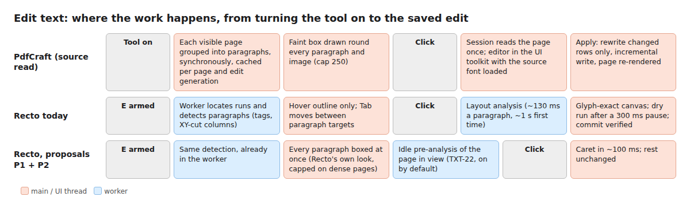
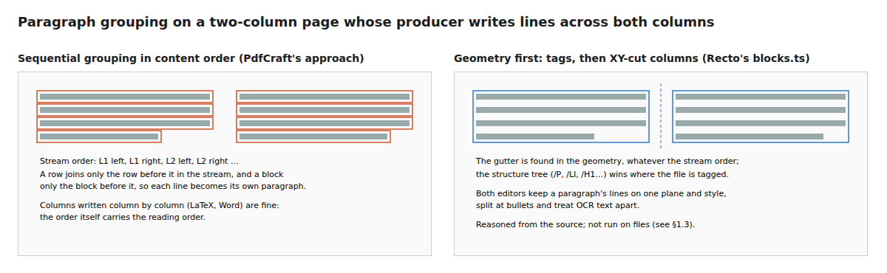

> Research snapshot of 2026-10-26 for the owner's ask (Turkish, paraphrased): "ArtCraft rebuilt
> the Adobe suite as open source; find out whether its PDF app edits text the way Acrobat does,
> with every paragraph active at once, whether it does anything technically smarter, and where
> Recto is already better." **The owner's rule (ART-1):** no reverse engineering of Acrobat and
> no copying. This study read only openly licensed source code (PdfCraft's, MIT OR Apache-2.0),
> PdfCraft's own documents, and Adobe's public help pages. No Acrobat binary was opened, nothing
> was decompiled, and no PdfCraft code was put into Recto; the ideas below are re-described in
> our own words and would be built from Recto's own specs. **PdfCraft was not built or run**
> (§1.3): it was cloned into an empty folder outside the repository
> (`/home/user/ext/printcraft`, commit `64e0868b`, 2026-10-26) and read with `cat` and `grep`.
> Behaviour claims about it are therefore read from the source and its docs, not observed.

# PdfCraft next to Recto

## 0. Verdict

**For the owner, in plain words.**

- **What it is.** ArtCraft's Acrobat replacement is called **PdfCraft**. It was first named
  **PrintCraft** and renamed on 2026-10-07 (its `ROADMAP.md`), which is why the press uses both
  names. Repository `github.com/storytold/pdfcraft` (the old `storytold/printcraft` address
  redirects to it), licence MIT OR Apache-2.0, written in Rust, a desktop app (macOS, Windows,
  Linux, FreeBSD) plus the same interface compiled for the browser. About 150k lines and 1,700+
  tests in its first month. Its own assessment: **alpha**, "≈ 50% ready for real work" against
  Acrobat Pro, and it lists "editing existing text is fragile on real files" as its third-biggest
  gap (`docs/gaps.md` gap 3).
- **Does it activate every paragraph at once?** **Yes, visibly.** When its Edit text tool is on,
  every paragraph and image on the visible pages gets a faint box at once (capped at 250 boxes a
  page for speed). Adobe's public help describes the same: in Edit mode Acrobat shows bounding
  boxes round the content, and a "Show bounding boxes" setting turns them off (§2.1). Under the
  hood PdfCraft is **not** doing more work up front than Recto: it groups the page's lines into
  paragraphs when the tool comes on, and everything heavier (fonts, layout) waits for the click.
- **Recto already detects every paragraph when Edit text is armed**, in the worker, and with a
  stronger method (the file's own paragraph tags first, then column detection). It just does not
  **show** them: you see an outline only under the pointer. So the "Acrobat feeling" the owner
  noticed is mostly a **display** choice, and Recto can have it cheaply (proposal P1). The
  slower part, the analysis that makes the caret appear fast, already exists behind
  `?textpre=1` (TXT-22: click to caret about 1 s → about 0.1 s on desktop); turning it on by
  default is proposal P2.
- **Where Recto is better:** paragraph detection on real layouts, keeping heavy work off the main
  thread, a glyph-exact live preview while typing, a verified write, Turkish and missing letters
  written in a real font (not drawn shapes), and touch, keyboard and IME on phones and tablets.
- **Where PdfCraft is ahead:** paragraph boxes you can drag to move or resize, editing the
  invisible text of scanned pages, using the document's own full font for new letters, its
  breadth (forms scripting, XFA, signing, compare, print) and a large robustness corpus.

**Top proposals** (full table in §5): P1 show every paragraph's box while Edit text is on;
P2 turn TXT-22's pre-analysis on by default; P3 drag a paragraph box to move it or to change its
width; P4 use the file's own full font for letters a subset lacks; P5 a robustness sweep over a
public corpus. P1, P2 and P5 are generic engineering; P3's gesture is a common editor convention
but its look must be Recto's own.

## 1. What PdfCraft is

### 1.1 Name, repository, licence

| | Finding | Source |
|---|---|---|
| Suite | ArtCraft, by Brandon Thomas and contributors (GitHub organisation `storytold`) | press (PetaPixel, Notebookcheck, 2026-10), `README.md` |
| App name | **PdfCraft**; was PrintCraft until 2026-10-07 | `ROADMAP.md` session 16 |
| Repository | `github.com/storytold/pdfcraft`; `storytold/printcraft` resolves to the same HEAD | `git ls-remote`, 2026-10-26 |
| Licence | MIT OR Apache-2.0 for code; ArtCraft name and logos are trademarks, not open source; bundled fonts OFL, icons ISC | `LICENSE-*`, `NOTICE`, `docs/brand/LICENSE-brand.txt` |
| Language, shape | Rust (edition 2024, Rust ≥ 1.95), 31 crates, 3 binaries (desktop, CLI, web), vendored `hayro` renderer and `lopdf` | `docs/architecture.md` |
| Maturity | alpha; feature breadth ≈ 67% (tier-weighted) of its Acrobat checklist; "ready for real work" ≈ 50%; text editing on real files called fragile | `docs/target-app-parity.md`, `docs/gaps.md` |

The licence would allow reuse with attribution, but the owner's rule is stricter: ideas and
techniques only, no code (ART-1). Nothing in this document quotes PdfCraft code.

### 1.2 How it is built

- **One object graph is the model.** The parsed PDF objects plus a copy-on-write overlay. An edit
  runs on a clone; the previous state goes onto the undo stack (100 steps); clones share
  unchanged data. After **every** edit an incremental write produces the working file, and the
  view is re-rendered from those bytes ("what you see is what Save writes"). Saves are
  incremental and atomic; a full rewrite only for redaction, PDF/A, password changes and Save As.
- **Rendering** on the CPU by the vendored `hayro` crates, with tiles for deep zoom, a render pool
  (visible pages first, then neighbours, then thumbnails) and a watchdog that skips pathological
  pages. The interface is egui on wgpu; the web build is the same egui shell in WebAssembly,
  drawn on a canvas.
- **Layers enforced by a build task**: geometry and filters at the bottom, the object parser, the
  content and font model, rendering and forms, one crate per tool family, then the engine façade
  and the frontends.
- **Quality gates**: fuzzing, a robustness sweep over the 983-file pdf.js test corpus ("0
  crashes"), a text-extraction oracle (word F1 0.98 against `pdftotext`), a parity task that
  checks every checklist claim cites a real command and test.

### 1.3 Why it was not run

Its workspace needs Rust 1.95; this machine has 1.94.1. Building it would mean installing a newer
toolchain and downloading and compiling about 780 third-party crates (each crate's build script
runs on the machine), plus `trunk` and the wasm target for the web build. That is unknown
software, so under the brief it was not done. Its four first-party build scripts were read: they
embed contributor credits and optional fonts from local folders and touch no network. The hosted
web build (`getartcraft.com`) was not reachable from this session. **Consequence:** the
side-by-side runs on `apps/web/test/fixtures/`, a two-column paper, a form, a Turkish document and
a scan were not made. §3's quality notes are read from the source. Running it would add measured
timings and screenshots; it needs the owner's approval to install the toolchain and dependencies.

## 2. Text editing in depth

### 2.1 "Every paragraph active at once"

- **PdfCraft.** With Edit text on, for each visible page the interface asks the engine for the
  page's paragraphs (cached per page and per edit generation) and strokes a faint box round each,
  on every frame. Images get boxes too. Past 250 boxes on a page only the hovered and selected
  ones are drawn, while hit-testing still covers all of them. The grouping runs **synchronously
  on the UI thread** the first time a page is seen after each edit; the engine keeps only the
  last page's result. Opening a paragraph then reads the page once into a session; drafts are laid
  out on a copy of the document, and the commit refuses if the document changed meanwhile.
- **Acrobat (public help only).** Adobe's Experience League "Edit text in a PDF" video says that
  in edit mode "you'll probably see bounding boxes around the content", with a gear-menu setting
  to show them; Adobe Community answers describe the "Show bounding boxes" checkbox, that each box
  is independent (typing does not push the next box down), and that OCR output may give one box
  per word. The help page "Adjust text boxes" describes dragging a box to move it and resizing it
  to rewrap the text without changing its size.
- **Recto.** On arming E, `TextEditLayer` locates runs and `analyzeParagraphs` detects paragraphs
  in the worker (`ParagraphEditSlot`); each paragraph becomes a keyboard target (Tab between them)
  and the runs are pointer targets. The **visible** feedback is the text layer's hover outline.
  With `?textpre=1` (TXT-22) the page in view also gets each paragraph's layout analysis at idle,
  which takes click-to-caret from 675–1244 ms to 117–130 ms on desktop.

So Recto already pays for detection up front; it is missing the display, and the deeper
pre-analysis is off by default.

### 2.2 Paragraph detection

| | PdfCraft (`crates/edit/src/text_regions.rs`) | Recto (`packages/engine/src/text-edit/blocks.ts`) |
|---|---|---|
| Order | Content-stream order; a row joins only the row before it, a block only the block before it | Recursive XY-cut over the page's pieces; columns found from gutters (TXT-12, TXT-14) |
| Tags | Marked-content paragraph scopes stop unrelated tagged regions merging | Structure tree first: `/P`, `/LI`, `/LBody`, `/H1`–`/H6` form one paragraph |
| Lines | Same plane, same style, baseline within 0.2 em (0.5 em for a super/subscript beside larger text), gap under 1.5 em | Runs cut at gaps over 3 × space (8 × with a space glyph); justified lines handled (TXT-10, TXT-15) |
| Paragraph | Aligned left, centre or right edge, leading 0.8–2.5 em, same horizontal scale; bullets open items, hanging indents continue them | Same family of rules plus drop caps, list markers, refusals with reasons |
| Rotated text | Compared in the text's own frame | Grouped by writing direction (1° buckets) in text space |
| OCR text | Lines never merge; words split at 0.6 em | Invisible runs form their own group; refused for editing |
| Where it runs | UI thread, on first sight of a page after each edit | Worker, on arming |

On files that write each column top to bottom (Word, LaTeX, most browsers) both get the same
answer. On a producer that writes lines across both columns, PdfCraft's order-based grouping
would turn every line into its own paragraph, where Recto's geometry still finds the columns
(reasoned from the code, not run).

### 2.3 Writing the edit back

Both editors keep untouched lines exactly as they were and rewrite only lines whose characters
changed or that moved because an earlier line rewrapped (Recto: research 11 §0, ADR-0020;
PdfCraft: `docs/editing-existing-text.md`). Both justify with `Tw` only where the space is
single-byte code 32 and use `TJ` offsets elsewhere (Recto TXT-16). Differences:

| | PdfCraft | Recto |
|---|---|---|
| Live preview while typing | The UI toolkit's text field, with the source font program loaded; advances come from the font program; rewrap shown on Apply | Glyph outlines from the PDF font on the real baselines with the PDF's advances; a dry run after 300 ms shows the true result |
| Hiding the old glyphs | Page rendered without the paragraph, shown only once the text changes; the editor's last look held until the new raster arrives | Plate from one dry run at open; `holdOverCommit` holds the editor over the commit |
| Style runs after an edit | Word-level diff (bounded) maps old runs onto the new text | Runs tracked by the editor model as you type |
| Letters the font lacks | Full matching face completes the subset when available; the file's own **full** embedded program if licensed; else **Type 3 glyphs drawn from bundled outlines** (240 per font) | A subset of a bundled real face (Inter, Noto Sans/Serif, JetBrains Mono) as a CID TrueType font |
| Verification | Tests and private acceptance runs | Every write read back (glyph origins within 0.01 pt), pixels outside the paragraph checked |
| Links and markup on moved words | Not found in the edit crate | Moved with their words |
| Move or resize a paragraph | Drag the box; side handles rewrap to a new width | Not available |
| OCR text | Editable: covered with the sampled paper colour and redrawn visibly in Helvetica | Refused (`invisible`) |
| Scripts | Arabic and Hebrew bidi, Indic, CJK line breaking (JIS X 4051) | Latin, Greek, Cyrillic substitutes; vertical text refused |

Type 3 fallback glyphs work everywhere but have no hinting and render less crisply at small
sizes; Recto's CID TrueType substitute is the better technique for Turkish letters missing from
a subset.

### 2.4 Caret, IME, touch, undo

PdfCraft's web build draws its interface on a canvas; text input goes through the toolkit's
hidden input, and the source shows no composition-specific handling or touch-first flow. Recto
edits through a DOM mirror that reads the browser's target ranges and compositions (TXT-6, TXT-18),
works by touch, pen and keyboard (Tab between paragraphs), and has a phone edition (EDN-17).
Undo: PdfCraft keeps 100 whole-document snapshots in memory; Recto keeps 200 steps in memory and
the last 20 in OPFS snapshots (ADR-0032).

## 3. Other features, briefly

| Area | PdfCraft | Recto | Note |
|---|---|---|---|
| Engine | Own parser and writer, vendored `hayro` renderer | PDFium in a worker; pdf-lib assembles (ADR-0002) | PDFium is the more proven renderer today; PdfCraft plans its own |
| Saving | Incremental write after every edit; atomic saves; signed files protected | Virtual model, bytes at export, edits replayable (ADR-0005, ADR-0011); OPFS snapshots | Different trade-offs; Recto's replay suits a browser |
| Annotations | Broad, appearance streams generated | Broad, with low-latency ink (research 12) | Comparable |
| Forms | AcroForm, JavaScript in a sandbox, FormCalc, XFA | AcroForm filling | PdfCraft broader |
| Pages | Organise, combine, split, page labels | Pages grid, organise | Comparable |
| Signing | PKCS #12 signing and validation | Research 08, ADR-0013 | PdfCraft further |
| Redaction | Full rewrite | Forensic self-check (RED-1) | Recto's verification stronger |
| OCR | `ocrs` (Rust), invisible text layer | Research 07, ADR-0012 | Comparable plans |
| Export | Images, text, RTF, Word, HTML | Images, Markdown, smaller, protected; Office in (ADR-0035) | Different focus |
| Platforms | Native desktop + canvas web | Browser-first PWA, phone edition | Recto better on touch and accessibility |

## 4. Generic engineering versus product design

**Fine to adopt (generic engineering, common across PDF tools and papers):** pre-computing page
analysis before the first click; drawing editable regions in edit mode; capping per-frame overlays
on dense pages; caches keyed by document revision; optimistic sessions that refuse a stale commit;
rewriting only changed lines; completing subset fonts from a full program when its embedding
licence allows; covering OCR words with a sampled paper colour; robustness sweeps over public
corpora and extraction oracles.

**Avoid copying (product-specific design):** PdfCraft's whole programme is measured as parity with
Acrobat's interface: an "All tools" pane, a quick-action toolbar, the Home view, Acrobat's menu
and tool names, a feature checklist mirroring Acrobat's. Recto has its own design language (glass,
capsule, dock; ADR-0022, ADR-0029) and should not follow either product's layout, names or
trade dress. For P1 and P3 only the idea (boxes in edit mode, drag to move or resize) is common
ground; the box's look, motion and the setting's wording are Recto's and the owner's to decide.

## 5. Ranked proposals for Recto

| # | Proposal | Gain | Cost | Risk | Files | Kind |
|---|---|---|---|---|---|---|
| **P1** | **Show every paragraph while Edit text is on.** Draw a quiet box round each paragraph `analyzeParagraphs` already returns, on arming; hide it under the open editor; cap at about 250 per page (then hover only); a setting to turn boxes off; refused runs keep their hatch on hover. | High: the owner's main ask; editable text is visible before any click | Low: 1–2 days; the data exists | Low: clutter on dense pages (cap), contrast on dark pages, phone width (compact edition decides separately) | `apps/web/src/text-edit/TextEditLayer.tsx`, `TextEdit.module.css`, `viewer/TextLayer.tsx` (hover outline), `messages/*.json` for the setting | Generic; look is owner taste |
| **P2** | **Turn TXT-22's pre-analysis on by default**, after the iPad check TXT-22 names; then extend it to the next page at idle with a per-page budget. | High: click to caret ~1 s → ~0.1 s (measured) | Low | Medium: worker contention on iPad, 6 MB heap on the sample | `apps/web/src/text-edit/paragraph-precompute.ts`, `text-edit-store.ts` | Generic |
| **P3** | **Move and resize a paragraph box**: drag the box to move the paragraph (with its links and markup), drag a side handle to rewrap to a new width. | Medium–high: a common expectation in edit mode | Medium: 1–2 weeks; layout already takes a width, moving needs a translate edit and replay | Medium: overlaps with neighbours, clips, rotated pages (handles only upright, as PdfCraft does) | `TextEditLayer.tsx`, `ParagraphEditor.tsx`, `packages/engine/src/text-edit/paragraph-edit.ts`, `overflow.ts`, a new engine edit | Generic convention; gesture look ours |
| **P4** | **Use the file's own full embedded font** for letters the encoding cannot show (e.g. a Word file with full fonts), before falling back to a bundled substitute; check the font's embedding permissions. | Medium: Turkish edits in the original face more often | Medium | Medium: fsType rules, re-encoding a simple font into a Type 0 | `packages/engine/src/text-edit/fonts.ts`, `paragraph-edit.ts` | Generic |
| **P5** | **Robustness sweep and extraction oracle**: run locate + detect over the pdf.js test corpus nightly (no crashes, bounded time per page) and score reading order against a reference extractor. | Medium: catches failures on real files early | Medium: CI time, corpus fetch (no new dependency) | Low | `tools/`, `.github/workflows/`, `packages/engine/src/text-edit/corpus-goldens.test.ts` | Generic |
| P6 | **Edit OCR text**: cover the old words with the paper colour sampled round them, draw the new words visibly. | Medium for scans | Medium | Medium: a visible patch; product choice for the owner | `editability.ts`, `blocks.ts`, `paragraph-edit.ts`, `viewer/page-pixels.ts` | Technique generic; behaviour is product |
| P7 | **Defer the plate until the first change**: on open, show the page's own text; render the paragraph-less plate only when the text changes. | Small: saves a dry run per open-and-leave | Low | Low | `apps/web/src/text-edit/ParagraphEditor.tsx` | Generic |

Not proposed: PdfCraft's incremental write after every edit (Recto's replayable model and OPFS
snapshots already cover recovery); Type 3 fallback glyphs (Recto's CID substitute is better);
order-based grouping (Recto's geometry is better).

## 6. What could not be verified

- PdfCraft was not run; no timings, screenshots or results on Recto's fixtures, a two-column paper,
  a form, a Turkish document or a scan (§1.3).
- Acrobat's internals: only its public help and community answers were read, per ART-1.
- PdfCraft's hosted web build and the press pages were unreachable; press facts come from search
  excerpts.

## Sources

- PdfCraft source at `64e0868b`: `README.md`, `ROADMAP.md`, `docs/architecture.md`,
  `docs/editing-existing-text.md`, `docs/gaps.md`, `docs/target-app-parity.md`,
  `docs/ui-parity.md`, `crates/edit/src/{text.rs,text_regions.rs,text_session.rs}`,
  `crates/engine/src/lib.rs`, `crates/ui-egui/src/{edit_text_ui.rs,canvas.rs}`.
- Adobe, "Edit text in a PDF" (Experience League):
  <https://experienceleague.adobe.com/en/docs/document-cloud-learn/acrobat-learning/getting-started/edit-pdf>
- Adobe, "Adjust text boxes" (Acrobat help):
  <https://helpx.adobe.com/acrobat/desktop/edit-documents/edit-text-in-pdfs/adjust-text-boxes.html>
- Adobe Community, "How do I turn off bounding boxes while editing a PDF in Acrobat":
  <https://community.adobe.com/questions-9/how-do-i-turn-off-bounding-boxes-while-editing-a-pdf-in-acrobat-1305744>
- PetaPixel, 2026-10-07:
  <https://petapixel.com/2026/10/07/someone-rebuilt-free-open-source-versions-of-photoshop-premiere-and-lightroom-using-ai/>
- Notebookcheck on ArtCraft:
  <https://www.notebookcheck.net/Photoshop-Premiere-more-Experienced-Rust-developer-recreates-Adobe-suite-with-AI-assistance-as-open-source.1419230.0.html>
- Recto: `docs/research/05-text-editing-spike.md`, `11-paragraph-text-editing.md`, ADR-0020,
  `docs/process/decisions/text-editing.md` (TXT-1…TXT-23).

Handoff for the text-editing workstream: [`artcraft-pdf/handoff-text-edit.md`](artcraft-pdf/handoff-text-edit.md).
